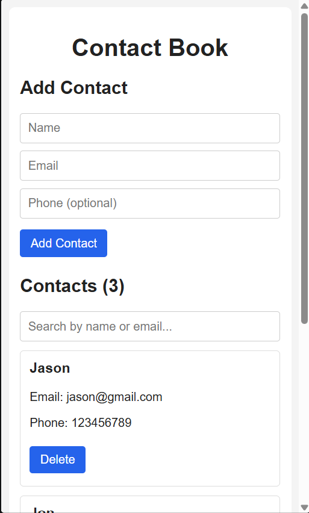
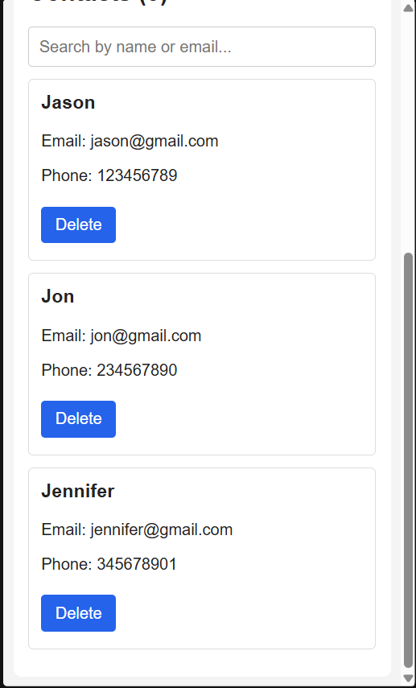
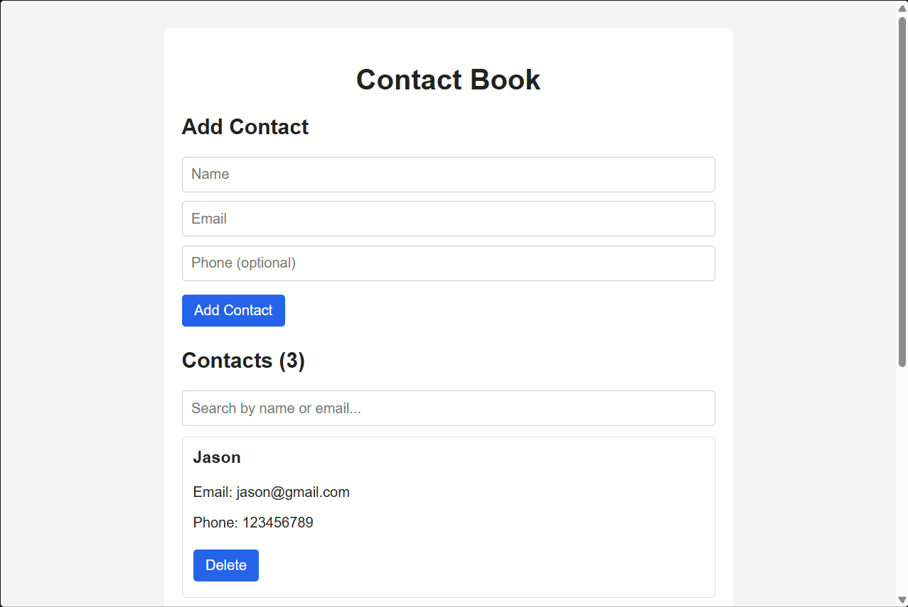
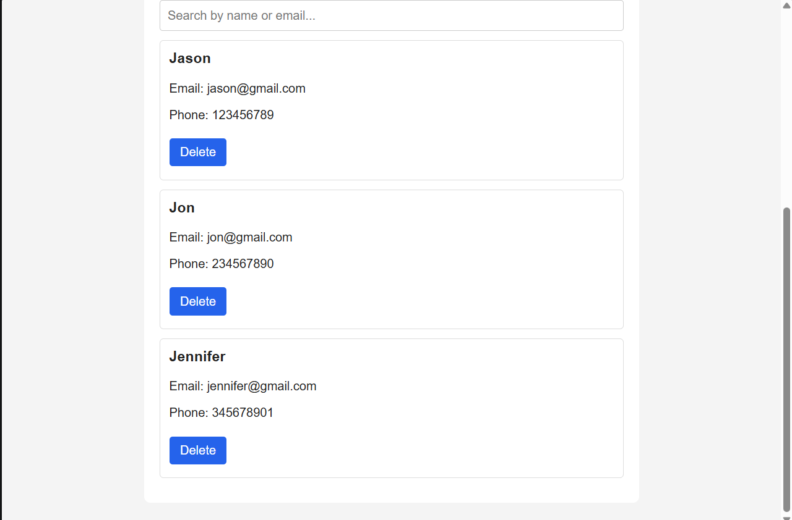
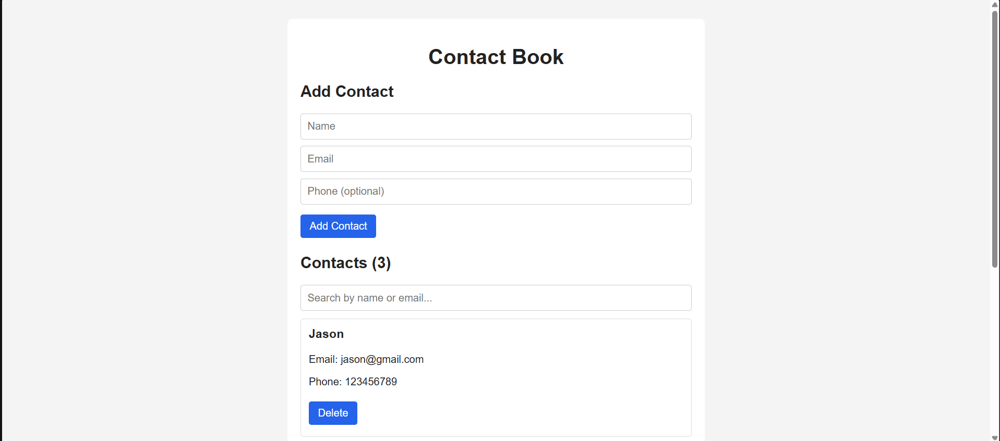
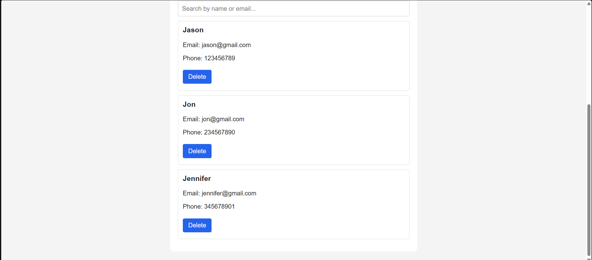

# Contact Book

A simple single-page Contact Book application built with **React** and
**Vite**. It lets users add contacts, view their contact list, search by
name or email, and delete contacts. Contact data is kept in React state
for the current session; no backend or database is required.

## Features

-   Add a contact with a name, email, and optional phone number.
-   Validate required name and email fields.
-   Perform basic email-format validation.
-   Display the contact list and total number of contacts.
-   Search by name or email, without case sensitivity.
-   Delete individual contacts.
-   Show helpful messages when the list is empty or a search has no
    matches.
-   Responsive layout for mobile, tablet, and desktop screens.

## Built With

-   React
-   Vite
-   JavaScript (JSX)
-   CSS

## Getting Started

### Prerequisites

Install a current version of [Node.js](https://nodejs.org/), which
includes npm.

### Installation

1.  Clone this repository:

    ``` bash
    git clone https://github.com/jasosnyd/Jason_Snyder_CIS-435_Projec2.git
    ```

2.  Change into the project directory:

    ``` bash
    cd Jason_Snyder_CIS-435_Project2
    ```

3.  Install dependencies:

    ``` bash
    npm install
    ```

4.  Start the development server:

    ``` bash
    npm run dev
    ```

5.  Open the local URL shown in the terminal (Vite commonly uses
    `http://localhost:5173`).

## How to Use

1.  Enter a name and email address in the **Add Contact** form.
2.  Optionally enter a phone number.
3.  Select **Add Contact** to add the contact to the list.
4.  Type into the search field to filter contacts by name or email.
5.  Select **Delete** on a contact card to remove it.

Contacts are stored in memory while the application is running.
Refreshing the page clears the current list.

## Screenshots


## Screenshots

### Mobile




### Tablet




### Desktop





## Project Structure

The app is organized into focused React components. Your repository may
have additional Vite starter files.

``` text
src/
├── components/
│   ├── ContactForm.jsx
│   ├── SearchBar.jsx
│   └── ContactList.jsx
├── App.jsx
├── App.css
├── index.css
└── main.jsx
```

-   **App** manages contacts and search state.
-   **ContactForm** handles controlled form inputs and validation.
-   **SearchBar** updates the search text.
-   **ContactList** renders contacts and empty-state messages.

## Notes

-   There is no backend or database.
-   Contacts are not saved permanently between page refreshes.
-   Screenshots are stored in the `assets/screenshots/` directory so they
    display in the GitHub README.
